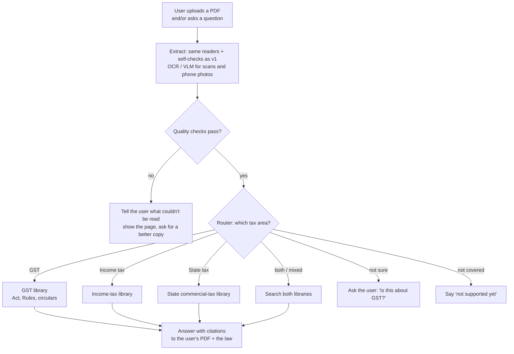

# FDE plan — taxowl after v1

**Status: ideas only. Nothing here starts until GST v1 is shipped** (deployed, evals on the quality page). Main plan: `plans/plan.md`.

## Why this project fits an FDE role

An FDE (Forward Deployed Engineer) takes a customer's messy real data, builds a working system for them, ships it and proves it works. taxowl already does most of that:

- **Messy real data:** 314 government PDFs, scans, tables split over 7 pages, an unofficial Rules source.
- **Decisions backed by measurement:** the table comparison, the OCR fixes, "cheap tool first, heavy tool only where it fails" (`plan_ingestion.md`, section C2).
- **A real domain with real users:** taxpayers and officers.
- **A public quality page**, which most portfolio projects skip.

### What's still missing (most important first)
| Gap | Why FDE interviewers care | Cost |
|---|---|---|
| **2–3 real users** (CAs, tax officers, people in GST work) trying it, with their feedback written up | FDE work is about customers. "Users said X, so I changed Y" is the strongest story you can tell | Low; start asking early, because people take time to reply |
| **Deployed, with a link anyone can open** | Shows you can deliver, not just build | Already in v1 |
| **Cost and speed numbers** (₹ per query, seconds per answer) | Customers ask about these first | Low; log them in v1 |
| **"Bring your own PDFs"** | This is the FDE job itself: a customer's documents arrive and the system copes | Medium; v2 |
| **A one-page case study:** problem → decisions → results → what's next | What you walk through in the interview | Low; the plans already record the decisions |

## How to picture v2

### The idea in one line
v1 answers questions from **our** GST library. v2 also answers questions about **the user's own documents** (a notice, an order, a reply), and it covers **more than one tax area**.

### The big picture

### Building blocks, in the order to build them

**1. Bring your own PDFs (GST only).**
- Uses the same extractor as v1. Section C2 already makes the readers swappable and gives every file a quality report.
- New here: scans and phone photos are common, so add a VLM reader. **The VLM suggests the grid, and the words come from the text layer or OCR**, the same principle as v1.
- If a page fails the checks, **tell the user** ("page 3 couldn't be read clearly") instead of answering from bad text.
- Privacy: user files are private, deleted after the session, and never added to the shared library.

**2. Router to the right tax area.**
- **A router, not an agent.** Deciding "is this GST or income tax?" is *one* decision. A single LLM call with a fixed list of answers (or even keywords like "CGST", "GSTIN", "Section 143(1)") is enough. An agent would be slower, cost more and be harder to test.
- Cases to handle:
  - **Mixed:** a notice can mention both GST and income tax, so allow more than one area.
  - **Unsure:** ask the user. One click is cheaper than a wrong answer.
  - **Not covered** (customs, a state law we don't have): say "not supported yet", never guess.
- **Test it like everything else:** about 50 labelled sample documents; measure how often it routes correctly.

**3. More tax areas (income tax, state commercial tax).**
- Each new area is a **"tax pack"**: its own sources, download script, parsers (its own law structure), evalset and quality-page row.
- The **pipeline stays the same**: extract → self-check → chunk by legal structure → search → answer with citations. Only the pack changes.
- Income tax is the biggest one and has the most users. State commercial tax differs from state to state, so start with one state.

**4. Agent, only where a task has many steps.**
- Example: *"Does this notice follow the circular it cites?"* The system must read the notice, find the circular, check whether it's still in force (v1's validity status), compare the two, and maybe search again.
- That's real multi-step work, so an agent earns its place here, not in routing.
- **Knowing when *not* to use an agent** is itself a strong interview point.

**Also deferred from `plan.md`:** tariffs (HSN → rate lookup) in v1.1, and High Court judgments in v2.

### Rules for v2
1. **Don't start before v1 ships.** A finished, measured v1 beats a half-built big project.
2. **Every new part gets its own measurement:** extraction quality on uploads, router accuracy, answer quality per tax pack. Each one goes on the quality page.
3. **Say "I don't know" instead of guessing:** bad extraction, unsure router, area not covered.
4. **The words come from the document, never a tool's guess.** This carries over from v1.

### One cheap thing to do in v1 for this
Give every chunk a `tax_area: "gst"` field now. In v2, a new tax pack is then just new chunks with a different `tax_area`, and search filters by it. There's no rebuild or migration. *(Not yet added to the v1 chunk metadata; decide when building `src/schema.py`.)*
