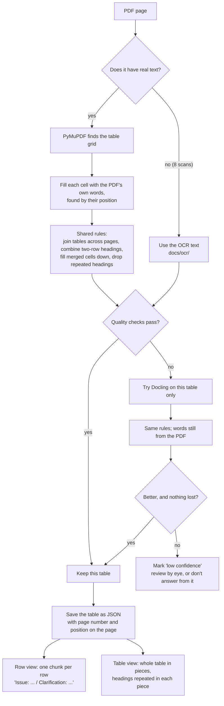

# Ingestion phase — checklist

Covers days 1–2 of `plan.md`: get the official documents, record where each one came from, split them into structural chunks, and load them into Chroma. The withdrawal detector (day 3) builds on this but is a separate step.

## v1 corpus (decided 2026-10-24)

| In v1 | Why |
|---|---|
| CGST Act, consolidated **as currently amended** | The law as it reads today. The 2022 PDF is too old: the 2024 Finance Act alone added s.16(5)–(6), s.74A and s.128A. |
| CGST Rules, consolidated as currently amended | Same reason. The Rules change through notifications every few months. |
| **All** CBIC CGST circulars (1/1/2017 → latest) | Many old circulars are still in force, and the validity chain needs the older circulars that later ones withdraw. |
| **All** GST instructions and guidelines | The tool is for officers as well as taxpayers, and instructions are written for officers. There are few of them and they look like circulars, so they're cheap to add. |
| Central Tax notifications **after 31-03-2026** that amend the Rules | The ICAI Rules PDF already includes everything up to that date. (Decided 2026-10-24: only 2 exist, and neither amends the Rules. One extends the GSTR-3B date; the other is about the Tribunal.) |

| Not in v1 | Why / when |
|---|---|
| Finance Acts, amending notifications | Only to **check** that the consolidated text is current. Amendment text ("for the words X substitute Y") makes poor chunks. |
| Tariffs (HSN → rate) | A table, not prose, so it gets a structured lookup in v1.1. |
| IGST Act | Known gap. Place-of-supply questions go in the evalset as out-of-scope, and the system should decline them. |
| Non-rate CGST notifications | High volume and short-lived. Revisit only if the consolidated Rules turn out to be stale. |
| HC judgments | v2. |

## Checklist

### A. Source verification (do before writing any code)
- [x] Find the newest consolidated CGST Act. **Done 2026-10-24 → India Code**, `https://www.indiacode.nic.in/indiacode/bitstream/123456789/15689/1/A2017-12.pdf` (131 pages, text layer OK). It's marked "As on the 11th June, 2026" and lists 15 amending Acts, up to the Finance Act 2026 (4 of 2026). Checks passed: s.16(5)–(6), 74A, 122B, 128A and 148A are all present. India Code is the Legislative Department's own site, so it outranks CBIC's PDFs (which say they have "no legal binding"). **Act as-of date = 2026-06-11.**
  - Completeness: it's 131 pages against ICAI's 154 for the Act, so checked by content, not page count. All sections 1–174 are present (42 and 43 appear as "Omitted by Finance Act 2022"), along with 12+ inserted sections (11A, 31A, 49A–B, 53A, 74A, 101A–C, 122B, 128A, 148A, 158A, 168A, …), Schedules I–III (the Act has only three) and the Statement of Objects and Reasons at the end. The page gap is layout only.
  - Parsing note: amended text is wrapped as `5[ … ]`, with numbered footnotes such as `5. Ins. by Act 23 of 2019, s. 92 (w.e.f. 1-1-2020).` Strip the markers from the text we embed, but keep each footnote as chunk metadata (`amended_by`, `wef`). That gives every section its amendment history for free.
- [x] Same for the CGST Rules. **Done 2026-10-24 → ICAI "GST Act(s) and Rule(s) – Bare Law"**, 12th edition (`docs/GST Act(s) and Rule(s)-Bare Law.pdf`, 442 pages). The foreword is dated 15-04-2026 and says it covers amendments **up to 31-03-2026**, including the Finance Act 2026 and the CGST (Fifth Amendment) Rules 2025. Checks passed: Rule 164 (procedure under s.128A) is present, and the newest notification cited is 20/2025-CT dated 31-12-2025, w.e.f. 01-02-2026. No official consolidated Rules text newer than 2021 was found (CBIC), so this is rung 1.5 on the ladder: **a trusted unofficial consolidation.** **Rules as-of date = 2026-03-31.**
  - **Cite** the amending notification named in each footnote, and link the official source. Never cite ICAI as the law.
  - **Footnotes contain the old text.** 278 of them say "Prior to substitution, it read …". Keep that text out of the chunk we embed, or retrieval will return superseded wording as if it were current. Store it as `history` metadata instead.
  - **Text quality.** pypdf splits words ("Liabili ty", "01.0 2.2026"). Try PyMuPDF before writing the parser, and normalise the dates in footnotes.
  - **Terms.** No copyright notice in the text layer, but 13 pages have no text (probably the cover and imprint), so check those by eye. Use the same excerpt-plus-official-link policy as everything else.
  - The PDF also has the IGST Act and Rules, so the IGST gap can be closed later from the same file. It stays out of v1 scope.
  - Cross-check: diff the ICAI copy of the Act against India Code. Where they disagree, that's a free test of the parser and of both sources.
- [x] Record the as-of date for each source. **Act as on 11-06-2026; Rules as on 31-03-2026; circulars, instructions and notifications as downloaded on 24-10-2026.** The UI shows these. They're also in the manifest (`as_of` on the Act and Rules rows).

#### Fallback ladder (for the Rules, or any source with no current consolidated text)
Try each step in order and stop at the first that works:
1. **An official consolidated text that is current.** For the Rules: the CBIC tax-information portal (a JavaScript app, so find its JSON API in DevTools), then India Code's subordinate-legislation tab for Act 12 of 2017.
2. **Official base + amendment overlay.** Take the newest official consolidated Rules PDF as the base (`as_of` = its date). Then download every "CGST (… Amendment) Rules" notification issued after that date (`doc_type=rule_amendment`). Chunk them by the rule they amend, with metadata `{amends_rule, notification_no, wef}`. When a rule chunk is retrieved, also fetch any overlay chunks for that rule and tell the LLM: "Rule X as of <base date>; amended by Notfn N w.e.f. D: <amendment text>". Don't write the amendments into the base text automatically. "Substitute X for Y" edits are easy to get subtly wrong, and a wrong consolidated rule is worse than an honestly layered one.
3. **Freeze and disclose.** If the overlay costs more than a day, ship the base alone. Show the as-of date in the UI, and add evalset questions about post-base changes that the system must answer by saying "this may have changed since <date>".
- Whichever step we land on, count how many rules changed after the base date. That number tells us how much the gap matters.
- [x] Find the official circular list. **The CBIC portal lists 267 CGST circulars: 256 numbered (1/1/2017 → 256/02/2026) + 11 corrigenda.** It also lists 4 IGST circulars and 1 compensation-cess circular, which are out of v1. The GST Council's 314 rows weren't reconciled in detail; the portal is the source we use.
- [x] Primary source for circulars, instructions and notifications: the CBIC tax-information portal's JSON API (see `scripts/01_download.py`). The portal was flaky (connections reset), so the script retries.
- [x] The Act and Rules are not taken from the portal. The Act comes from India Code and the Rules from ICAI, both downloaded by hand.

### B. Download script + manifest
- [x] Repo setup: git, `.gitignore`, `pyproject.toml` with uv. (Check that `docs/` PDFs are git-ignored, since we link to sources rather than re-host them.)
- [x] `scripts/01_download.py`. **Done 2026-10-24.** It calls the portal's JSON API (list endpoint → metadata; download endpoint → base64 PDF) and saves to `docs/<type>/<year>/<number>.pdf`. It has:
  - [x] retries with growing waits, plus a 1 s pause between downloads;
  - [x] skipping files already present and complete, so a re-run only fetches what's missing;
  - [x] a complete-PDF check (`%PDF` at the start, `%%EOF` at the end);
  - [x] a text progress bar with time left;
  - [x] a fix for CBIC's incomplete certificate chain: it fetches the missing intermediate certificate, and the chain must still end at a trusted root.
- [x] `docs/manifest.jsonl`, one row per document: `doc_type, number, title, date, portal_id, official_url, download_api, file, bytes, sha256, fetched_at`. The Act and Rules rows come from `MANUAL_DOCS` in the script and add `as_of, publisher, official`.
- [x] Check: **314 rows = 267 circulars + 43 instructions + 2 notifications + Act + Rules.** All are valid PDFs, and the counts match the portal's lists.

### C. Parse into structural chunks
- [x] Check text quality first. **Done 2026-10-24 with `ingestion/check_scans.py`** (report: `ingestion/scan_report.csv`).
  - **8 files are real scans** (about 37 pages): circulars 228/2024, 229/2024 and 247/2025, plus instructions 03/2022, 04/2022, 01/2024, 01/2020-21 (investigation) and 01/2026. All 8 were checked by eye. 7 are plain paragraphs. Instruction 01/2020-21 ends with a 2-page empty form (headings only).
  - 4 files flagged `part_scan` are fine. Their empty pages are covers, blank pages or section title pages.
  - Some files *look* scanned (tilted, stamped) but have a hidden text layer, e.g. circular 56/2018. In LERAGS such layers were often wrong on numbers, so spot-check one when building the extractor.
- [x] OCR the 8 scans with **`ocrmac` (Apple Vision)**. **Done 2026-10-25:** `ingestion/ocr_scans.py` writes `docs/ocr/<same path>.txt`, with pages separated by `\f`. Mark the chunks `ocr: true` later. Problems found and fixed: paragraph numbers skipped (re-read the left margin with both Apple engines, Vision and LiveText); lines merged on tilted pages; numbers on a line of their own; garbled date ordinals; "SI. No.". Inserted numbers must start a sentence and fit the paragraph sequence, because the first version of the fix put numbers on the page that weren't there. Checked against page images: circular 229/2024 in full, plus every spot where a problem showed up. Rates, HSN codes and notification numbers were correct. Every paragraph sequence is now complete.
- [x] Check for tables. **Done 2026-10-24** (report: `ingestion/table_report.csv`). Two independent methods ran on every page of all 304 text files: PyMuPDF `find_tables()`, and a count of drawn horizontal and vertical lines. They agreed on 296 files; the 9 disagreements were checked by eye (6 real tables, 3 not).
  - **About 110 of 304 files have tables** (about 1 in 3). **0 misses in 28 "no tables" files checked by eye** (13 by Claude, 15 by the user).
  - The kinds of table: **Q&A tables** (S.No / Issue / Clarification, e.g. circular 238/32/2024 on s.128A), which are the content itself; **tables of limits or assignments** (e.g. 254/11/2025); and **blank forms** (e.g. MOV-01 in 41/15/2018), which are low value.
- [ ] The extractor needs **two modes**: plain text, and tables **row by row**. Each row becomes one chunk with its column names (`Issue: … Clarification: …`). This is the LERAGS lesson: flattening tables left 55.6% of rows without their headings, and keeping structure cut that to 5.9%.
  - **Tables split across pages.** If a table ends at the bottom of a page and the next page starts with a table with the same number of columns, join them before chunking. **Test case: circular 254/11/2025, Table III (pages 5–6).**
  - **Nested tables:** circular 133/03/2020 has a table inside a table (confirmed by the user). Decide how to handle it when building.
  - Blank forms: keep one chunk with the form's title and headings only.
- [ ] **Table extractor comparison** (do this before building `src/extract.py`). PyMuPDF on its own fails on the hard cases. Measured 2026-10-24:
  - Split tables come out as one table per page, with the headings lost on continuation pages (`Col1, Col2…`). A Q&A row can break mid-answer, continuing as a row with an empty S.No.
  - Nested tables: the inner table is found, but the outer columns come out empty around it.
  - ⚠️ **Numbers get damaged:** `10,00,000` → `1000000 , ,` (133/03/2020, page 5).
  - Missing spaces ("Officerof CentralTax") and broken headings ("S . No .").
  - **Compare:** (a) PyMuPDF + our own rules (join split tables by column count, merge rows with an empty S.No into the row above, reuse the first part's headings, clean up text) vs (b) Docling's table model. Run both on the test set below and check by eye: are rows complete, do cells keep their headings, are **numbers exactly right**? The winner handles all ~110 table files. Plain-text files stay on PyMuPDF either way.
  - **Hard test set (9 files, chosen by scanning all table files and confirming the nested ones by eye):**

    | Hard case | File | Where |
    |---|---|---|
    | Split across pages | `circulars/2024/238-32-2024-GST.pdf` | Q&A table, pages 8–14 (7 pages) |
    | Split across pages | `circulars/2018/75-49-2018-GST.pdf` | pages 23–27 (5 pages) |
    | Split across pages | `circulars/2025/254-11-2025-GST.pdf` | Table III, pages 5–6 |
    | Nested (+ split) | `circulars/2020/133-03-2020-GST.pdf` | worked example inside an answer, page 5; damaged numbers |
    | Nested (+ split) | `circulars/2020/136-06-2020-GST.pdf` | date/interest table inside an answer, page 4 |
    | Nested (+ split) | `circulars/2019/123-42-2019--GST.pdf` | "Case 1 / Case 2" inside an answer, page 4 |
    | Blank form | `circulars/2018/41-15-2018-GST.pdf` | MOV forms, ~88% empty cells |
    | Blank form | `circulars/2019/99-18-2019-GST.pdf` | ~92% empty cells |
    | Two-row headings | `circulars/2022/182-14-2022-GST.pdf` | page 13 ("Amount" → CGST / SGST) |

  - Other files found by the same scan, for later checks. Long split runs: 160/16/2021, 167/23/2021, 146/02/2021, 134/04/2020, 125/44/2019, 27/01/2018, 195/07/2023, 203/15/2023. Forms with two-row headings: 24/24/2017, 17/17/2017, 125/44/2019 (Annexure-B). Scan output: scratchpad `hard_tables.json` (to be regenerated into `ingestion/` if needed).
  - [x] **Comparison done 2026-10-25** (`ingestion/compare_tables.py`, output in `ingestion/table_compare/`). There's no single winner. The strategy chosen from it is in **section C2** below.

### C2. How we read tables: the strategy (decided 2026-10-26)

#### The problem, in one paragraph
A table only makes sense together with its headings. "Delhi | 70% | 10,00,000" means nothing unless you know the columns are *State*, *Share* and *Limit*. If we pull a table out as plain text, the headings get separated from the values, and neither the search nor the LLM can tell what a number means. So we need to read tables **with their structure**: which cell belongs to which row and which column. Tables in our PDFs are hard: they run over 7 pages, sit inside other tables, have merged cells, two-row headings and sometimes no drawn lines at all.

#### What the comparison taught us (9 hardest files)
| | PyMuPDF + our rules | Docling |
|---|---|---|
| Long Q&A table over 7 pages (238/2024) | ✅ joined into one | ❌ split in two, headings lost |
| Table with no drawn lines (99/2019) | ❌ 49 junk rows | ✅ clean |
| Registers and forms (75/2018, 182/2022) | more junk rows | fewer junk rows |
| **Dropped content** | never | ❌ **a whole table silently missing** (123/2019) |
| Speed | seconds | about 3 minutes for 9 files |

Three lessons:
1. **No tool is best everywhere.** Each fails on different tables.
2. **Silent loss is the worst failure.** A messy table can be seen and fixed; a missing table can't be seen at all.
3. **Our own rules mattered as much as the tool.** Joining pages, repeating headings and filling merged cells fixed most problems for *both* tools.

#### The three principles
Think of it like a careful clerk copying tables from a law book.

1. **The words come from the PDF, never from a tool's guess.** Our PDFs already contain the exact text (except the 8 scans). A tool may decide *where* the rows and columns are, but the words inside each cell are copied from the PDF's own text. Then a tool can never change "18%" into "28%".
2. **Use the cheap tool first; use the heavy tool only where the cheap one failed.** PyMuPDF is fast and exact. Docling runs only on the **single table or page** that failed, not on the whole file.
3. **Every result checks itself.** No human will look at most of the 314 files, and none at the PDFs users upload later. So the eye-checks we did by hand become automatic checks. If a result fails them, we **say so** (flag it, or refuse to answer from it) instead of quietly using it.

#### The flow, step by step



The same in words:
1. **Is there text?** If not (the 8 scans), use the OCR text we already made.
2. **Find the grid with PyMuPDF**, then fill each cell with the PDF words that sit inside it.
3. **Apply our shared rules** to fix split tables, headings and merged cells.
4. **Check the result.** If it passes, keep it.
5. **If it fails, try Docling on that table only**, with the same rules and the words still taken from the PDF. Keep Docling's version only if it scores better **and** lost nothing.
6. **If both fail, don't hide it.** Mark it low-confidence for a human or for the answer step.
7. **Save the table once, as JSON** (the "master copy"), then make two search views from it.

#### The quality checks (the "self-check")
| Check | What it catches | Example from our files |
|---|---|---|
| **PDF → output:** every word on the page appears in the output | **Dropped** text | Docling losing the table in 123/2019 |
| **Output → PDF:** every word in the output exists on the page | **Invented or changed** text | Matters most for a VLM later |
| **Numbers match exactly:** amounts, rates, dates, section numbers | The most dangerous kind of mistake | `10,00,000` → `1000000 , ,` (133/2020, an early version) |
| No junk rows; no "Column 3"-style headings | A badly read grid | PyMuPDF on 99/2019 |
| Same columns and headings on every page of a long table | Bad joins across pages | 136/2020, page 5 |
| Paragraph numbers in order (1, 2, 3…) | Lost or extra text in OCR | already used in `ocr_scans.py` |

**Allowed exceptions** (otherwise every long table would fail the word-checks): headings repeated on continuation pages, page headers and footers, and page numbers. We drop these on purpose.

**How we know the checks themselves work:** they're tested against the 9 files we checked by eye. They must flag PyMuPDF on 99/2019 and Docling on 123/2019, and pass 254/2025. If the checks get those right, we can trust them on files nobody has looked at.

#### What we save, and how it's searched
- **Master copy: JSON per table.** It holds the caption, the section or paragraph it sits in, the headings (with levels, e.g. "Amount → CGST"), the rows, and for every row its **page number and position on the page**. The position lets a citation point to the exact spot, so a user can check the answer against the PDF.
- **Row view** (one chunk per row, every value with its heading) answers questions like "what is the limit for Delhi?".
- **Table view** (the whole table, cut into pieces small enough for one chunk, with headings repeated in each piece) answers questions like "summarise this table". The 7-page Q&A table in 238/2024 is far too long for one chunk, which is why it's cut into pieces.
- **Search uses keywords + meaning together** (hybrid search). Meaning-based search alone is weak on exact legal terms like "rule 36(4)" or "₹10,00,000"; keyword search catches those.

#### What we are NOT doing now, and why
- **Vision-language parsers** (MinerU, PaddleOCR-VL, olmOCR…). They look at a page image and *re-type* it. That's great for scans and phone photos, but risky for born-digital legal text, where the exact text is already in the PDF. **Later, for user uploads:** let a VLM suggest the grid, then fill the cells with the PDF's own words, exactly as we do with PyMuPDF today. That way we get the VLM's layout skill without its typing mistakes.
- **Building the user-upload feature.** We only keep the door open: in `src/extract.py` each tool is one swappable "reader" function, so adding a VLM later is one more function, with no redesign.

#### Nested tables (checked 2026-10-27)
- **Finder:** `ingestion/find_nested.py` → `ingestion/nested_report.csv`. PyMuPDF doesn't return a nested table as two tables; it merges the inner grid into the outer one (133/2020, page 5: 10 columns instead of 3). The rule looks for rows whose cells all sit inside one wide cell of another row.
- **Result: 6 of 111 table files flagged.** 133, 136, 123 (known), 75/49/2018 page 10 (a form with a CGST/IGST/Total sub-grid inside a cell): **4 real**. 26/26/2017 (a three-level heading grid) is borderline; HTML suits it anyway. 99/18/2019 is a false alarm. A false alarm is cheap (HTML instead of Markdown), so the rule leans towards "nested".
- **Missed ones?** The first version flagged 23 files. All 17 dropped by the fix were checked by eye: section-heading rows, forms and an index, none nested. Files the rule never flagged weren't checked page by page.
- **Docling on nested tables:** it reads the **inner** table cleanly (133: every number right, columns named), but **loses the outer table around it**. In 133, pages 4–6 have no outer table at all; in 136, Q&A rows 6–8 on page 4 are missing from the tables (they may have gone to plain text; not checked). PyMuPDF keeps everything but mashes both grids together.
- **Plan:** these files get HTML (C2). Building the outer + inner structure correctly is done with our own rule in `extract.py`, tested on 133, 136, 123 and 75.

#### When do we change this plan?
After `src/extract.py` runs on all 314 files, count the flagged tables. **A handful** → fix them with the Docling fallback, and we're done. **Many** → test a VLM arm on the same 9 files before going further. We decide from data, not guesses.

> Interview line: *"I kept the PDF's own text as the source of truth, used the cheap exact tool by default, routed only the failing tables to a heavier model, and turned my manual checks into automatic checks, tested against hand-checked files."*
- [ ] Act → one chunk per **section**, keeping sub-sections, provisos and explanations with their section. Split very long sections by sub-section.
- [ ] Rules → one chunk per **rule**. Leave Part B forms out of v1 (or index only their titles), because forms are tables and boilerplate.
- [ ] Circulars → one chunk per **numbered paragraph**. Put the circular's subject line into every chunk, since paragraphs make little sense without it.
- [ ] Chunk metadata: `{doc_type, number, date, section_or_para, title, official_url, status, withdrawn_by, source_sha256}`. `status` defaults to `in_force` until the day-3 detector fills it in.

### C3. Ingestion harness and its eval (agreed 2026-10-27)

**Goal:** a document counts as ingested only after the harness says it was read correctly. This holds for our 314 files now and for user uploads later. Vectorisation comes after this.

#### The harness: three layers
```
PDF → read (PyMuPDF; Docling for scans, because it also gives table structure)
    → Layer 1: rule checks     every page, free, exact
    → Layer 2: LLM judge       structure; only tables, flagged pages and a random sample
    → Layer 3: human           where both are unsure
    → only then is the document "in"
```
- **Layer 1, rules:** every word present; numbers exact; no junk rows; columns consistent; labels right (number, date, link); not a duplicate (sha256). Counting is code's job; an LLM can itself get it wrong.
- **Layer 2, LLM judge:** sees the **page image + our output** and answers "does this match?". It catches what rules can't: a value under the wrong heading, a shifted row, a misread merged cell. **It only gives a verdict and never edits text**, or wrong numbers could creep back in. Run it only where it's needed, because a call on every page is expensive.
- **Layer 3, human:** only the cases both layers doubt.

#### The eval for it (component eval, goes on the quality page)
| Question | How | Number |
|---|---|---|
| How correctly is text read? | Hand-made correct answers for some pages, compared with the output | % words right, % numbers exact |
| How correct are tables? | Each cell: under the right heading? | % cells in the right place |
| Does the harness catch bad output? | Deliberately damaged output: drop a row, change a number, shift columns | % caught (recall) |
| Does it block good documents? | Run it on correct documents | false-alarm rate |
| Can we trust the LLM judge? | Judge vs user on the same pages | % agreement |

- **First run, 2026-10-27.** `src/taxowl/extract.py` + `tables.py`, scored by `evals/check_ingestion.py`: gold 256/256. All 314 files in about 2 minutes, and no file lost words. 22 files flagged by the self-check (14 tables without headings, 9 sparse tables, 1 invented word), still to look at. Because the rules were built on the gold pages, the 100% may be overfitting: test on held-out pages next.
- **Held-out test, 2026-10-28.** 10 pages drawn at random (`evals/draw_heldout.py`, seed 2026: 5 table, 1 scan, 2 plain, 1 Act, 1 Rules; none from the gold files) → `evals/ingestion_heldout.json`, written from page images, verified by GPT (Codex) and the user. Same extractor and checker (`--gold` option): **held-out 152/164 (92.7%)** vs gold 256/256. Numbers 23/23; Act, Rules, OCR, plain pages and both split tables all passed. The 12 failures come from 4 causes, each seen once (so how common each one is is still unknown):
  1. Footer kept on 2-page documents: `strip_headers` skips fewer than 3 pages (194/2023). Coverage gap.
  2. Footer kept on page 1 when a table reaches the page bottom (219/2024). Cause not yet confirmed.
  3. Empty form table (headings only, 0 data rows) missing from the output, and **no flag raised** (63/2018, p.10). A hole in the safety net.
  4. **Partly scanned file:** text layer for the body, the table is only a picture → headings "Column 1-3", no cells; the text layer also lost "24th"/"31st" (56/2018). Content lost, but the self-check DID flag it (tables_without_headings).
  This 92.7% is the held-out number for the quality page. Once these are fixed, these pages count as seen; a fresh draw (new seed) is needed for the next held-out score.
- **Goal for tables (agreed 2026-10-28):** every table comes out right OR is flagged and handled; never wrong without a flag. Next steps: (1) sort the 22 flagged files' tables into fine / picture / broken, using page images from a small script; (2) choose the fix from the counts (handful → Docling/region OCR, many → test a VLM); (3) add a check for tables that disappear (PyMuPDF sees a table, output has none); (4) at answer time, cite the PDF page and mark chunks from flagged tables. Small fixes (2-page footers, 219) after step 1.
- **Gold set: done 2026-10-27.** `evals/ingestion_gold.json`: 11 cases, 13 pages, 230 checks. Written from page images (not from any extractor's output), and every case verified against the PDF by the user.
- **Damaging output on purpose** is the strongest test: we know where the mistake is, so we know whether it was caught.

### D. Ingest into Chroma
- [ ] Copy and adapt `store.py`, `embeddings/models.py` and `config.py` from LERAGS. Revise each together (code from LERAGS only, never data).
- [ ] Incremental ingest: `has_source(sha256)` skips documents already in the store.
- [ ] `scripts/03_ingest.py` prints chunk counts per `doc_type`.

### E. Verification (the phase is done when all of these pass)
- [ ] Every chunk has a non-empty `official_url` and `status`.
- [ ] Chunk counts look right: Act ≈ 174 sections plus inserted ones (11A, 74A, 128A…), and every circular has at least one chunk.
- [ ] Spot-check 10 random chunks against the source PDF or page, covering the text and the section or paragraph number.
- [ ] Re-running download and ingest makes no changes (idempotent).
- [ ] A smoke query, `search("time limit to claim ITC")`, returns s.16 in the top 5.

## Who does what
- **You:** section A (reading the sources, the as-of decision), the spot-checks in E, and reviewing every copied LERAGS module.
- **Claude:** the download and parse plumbing in B–C, drafted for you to review.

## Open questions
- ~~Is the CBIC portal's Act/Rules text current?~~ Settled: the Act comes from India Code and the Rules from ICAI (section A).
- ~~How many circulars are scans?~~ Settled: 8 files, which get OCR (section C).
- ~~How to chunk nested tables (circular 133/03/2020)?~~ Settled: 4–5 files, written as HTML (C2, "Nested tables").
- Do any Act changes made after 11-06-2026 need a notification check? (Finance Act 2026 provisions may be printed in the Act but not yet in force.)

## Ingestion files to build (agreed 2026-10-24)
PDF → text → split by law structure → chunks → vectors → database.

| File | Job | Status |
|---|---|---|
| `scripts/01_download.py` | Download + manifest | done |
| `ingestion/check_scans.py` | Find scans | done |
| `ingestion/ocr_scans.py` | OCR the 8 scans | done |
| `ingestion/compare_tables.py` | PyMuPDF vs Docling on the 9 hardest table files | done |
| `ingestion/find_nested.py` | Find tables inside tables | done |
| `src/config.py` | Paths and settings | reuse from LERAGS |
| `src/schema.py` | What a chunk looks like (text + metadata) | new |
| `src/extract.py` | PDF → clean text, tables as JSON, and a quality report per file (section C2) | new |
| `src/parsers/act.py` | Act → sections, footnotes as history | new |
| `src/parsers/rules.py` | Rules → rules, "prior to substitution" text kept out | new |
| `src/parsers/circulars.py` | Circulars, instructions, notifications → paragraphs, with the subject in each | new |
| `src/chunker.py` | Cut long pieces by sub-section and add headings | new |
| `scripts/02_parse.py` | Run all of the above → `chunks.jsonl` (checked by eye before embedding) | new |
| `src/embeddings/models.py` | bge-small vectors | reuse |
| `src/store.py` | Chroma | reuse |
| `scripts/03_ingest.py` | `chunks.jsonl` → Chroma | new |
| `scripts/04_check.py` | Section E checks | new |
| `tests/test_parsers.py` | Parser tests (include 254/11/2025 Table III) | new |
